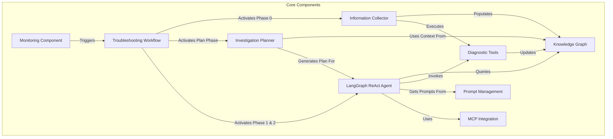
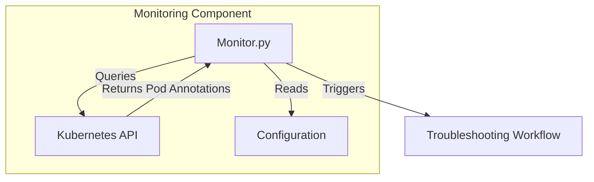
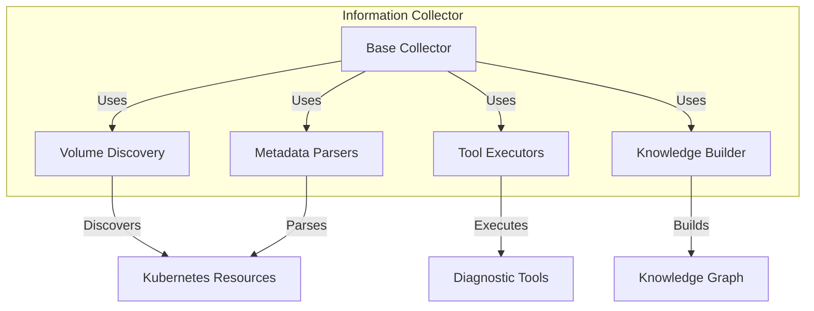
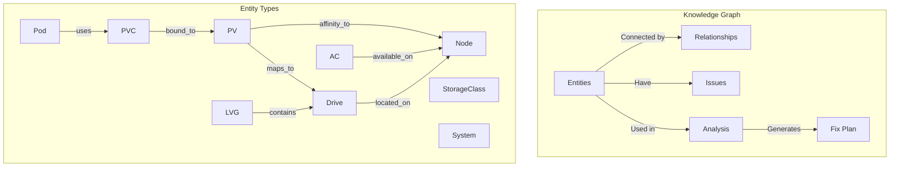
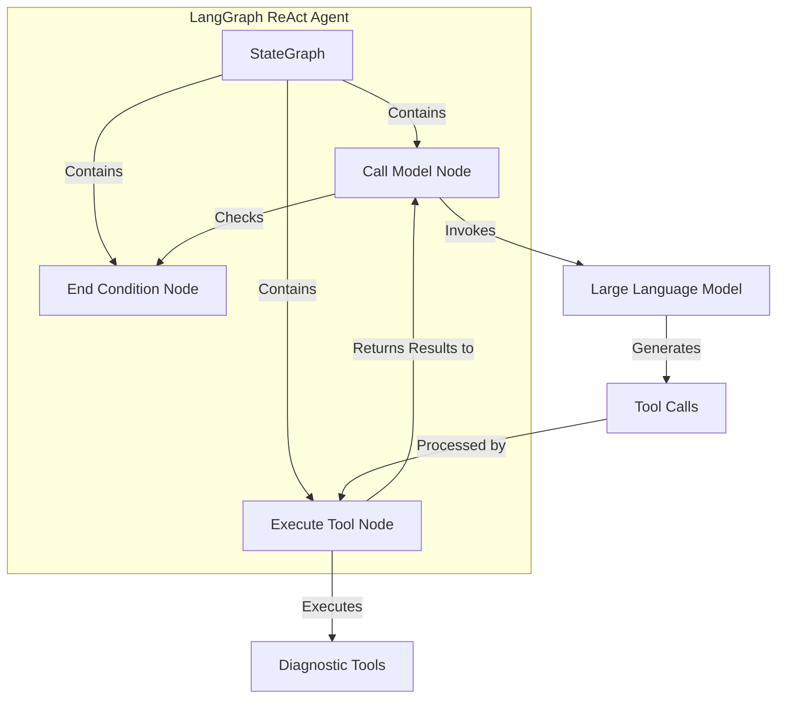
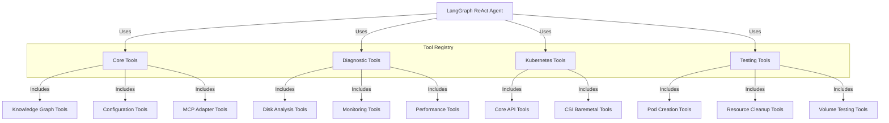
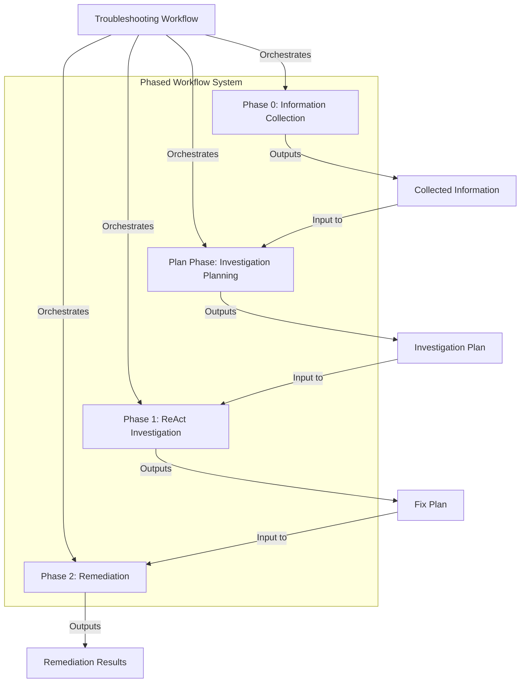

# Cluster Storage Troubleshooting - Components Relationship Chart

This document provides a visual representation of the high-level components and their relationships in the cluster-storage-troubleshooting project.

## Core Components Overview

The following diagram illustrates the main components of the system and their relationships:



## Detailed Component Relationships

### Monitoring Component Relationships



### Information Collector Relationships



### Knowledge Graph Relationships



### LangGraph ReAct Agent Relationships



### Tool Registry Relationships



### Phased Workflow Relationships



## System Integration Diagram

```mermaid
graph TD
    subgraph "External Systems"
        K8s["Kubernetes Cluster"]
        Nodes["Worker Nodes"]
        LLMProvider["LLM Provider"]
        MCPServers["MCP Servers"]
    end
    
    subgraph "Cluster Storage Troubleshooting System"
        Monitor["Monitoring Component"]
        TWF["Troubleshooting Workflow"]
        InfoCol["Information Collector"]
        KG["Knowledge Graph"]
        IP["Investigation Planner"]
        ReAct["LangGraph ReAct Agent"]
        Tools["Diagnostic Tools"]
        PM["Prompt Management"]
        MCP["MCP Integration"]
    end
    
    Monitor -->|"Monitors"| K8s
    InfoCol -->|"Collects from"| K8s
    InfoCol -->|"Collects from"| Nodes
    Tools -->|"Interacts with"| K8s
    Tools -->|"Interacts with"| Nodes
    ReAct -->|"Uses"| LLMProvider
    MCP -->|"Connects to"| MCPServers
    
    Monitor -->|"Triggers"| TWF
    TWF -->|"Activates"| InfoCol
    InfoCol -->|"Populates"| KG
    TWF -->|"Activates"| IP
    IP -->|"Uses"| KG
    IP -->|"Generates Plan for"| ReAct
    TWF -->|"Activates"| ReAct
    ReAct -->|"Queries"| KG
    ReAct -->|"Invokes"| Tools
    ReAct -->|"Gets Prompts from"| PM
    ReAct -->|"Uses"| MCP
