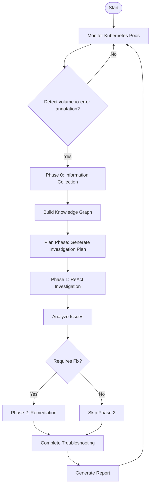
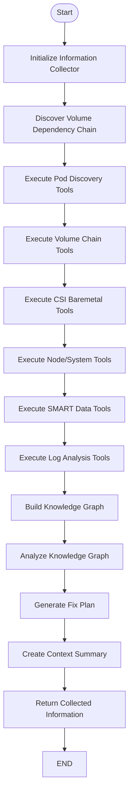
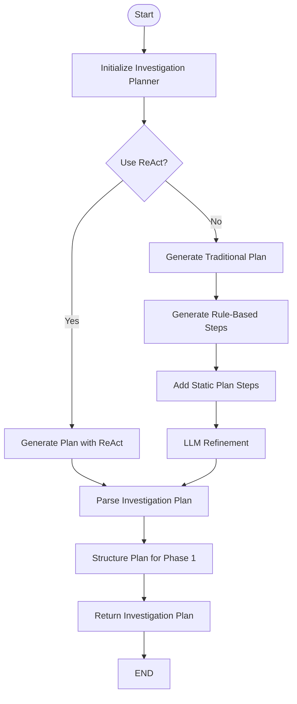
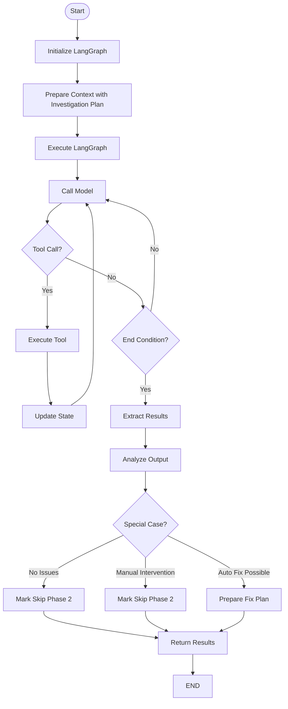
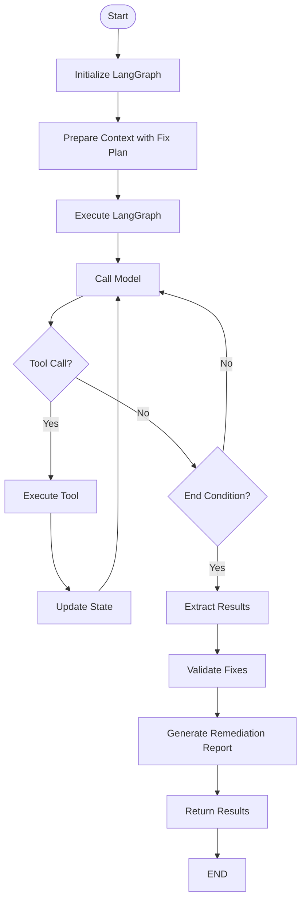
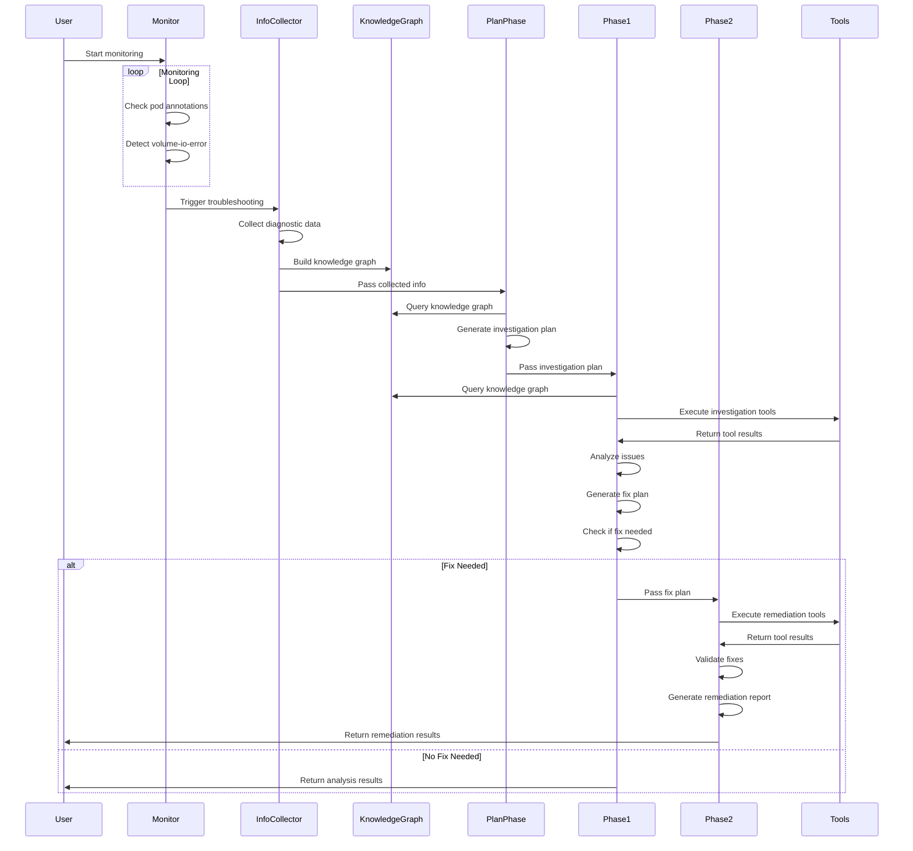

# Cluster Storage Troubleshooting - Main Workflow Chart

This document provides a visual representation of the main workflow in the cluster-storage-troubleshooting project.

## Overall Troubleshooting Workflow

The following diagram illustrates the complete workflow of the system, from monitoring to remediation:



## Detailed Phase Workflows

### Phase 0: Information Collection



### Plan Phase: Investigation Planning



### Phase 1: ReAct Investigation



### Phase 2: Remediation



## End-to-End Sequence Diagram



## LangGraph ReAct Loop

The LangGraph ReAct agent operates in a loop of reasoning and acting:

```mermaid
graph TD
    subgraph "LangGraph Core Architecture"
        START([Start]) --> callModel[Call Model Node]
        callModel --> toolsCondition{Tools Condition}
        toolsCondition -->|"Tool calls detected"| serialToolNode[Serial Tool Node]
        toolsCondition -->|"No tool calls"| endCondition[End Condition Node]
        serialToolNode --> callModel
        endCondition --> endCheck{Meet End Criteria?}
        endCheck -->|Yes| END([End])
        endCheck -->|No| callModel
    end

    subgraph "SerialToolNode Execution Flow"
        serialToolNode --> parseTool[Parse Tool Call]
        parseTool --> validateTool{Valid Tool?}
        validateTool -->|No| errorMsg[Return Error Message]
        validateTool -->|Yes| executeTool[Execute Tool Sequentially]
        executeTool --> toolResponse[Create Tool Message Response]
        toolResponse --> returnToModel[Return to Call Model]
    end

    subgraph "State Flow"
        callModel -->|Update Messages State| updateState[Update State]
        serialToolNode -->|Add Tool Results to State| updateState
    end
